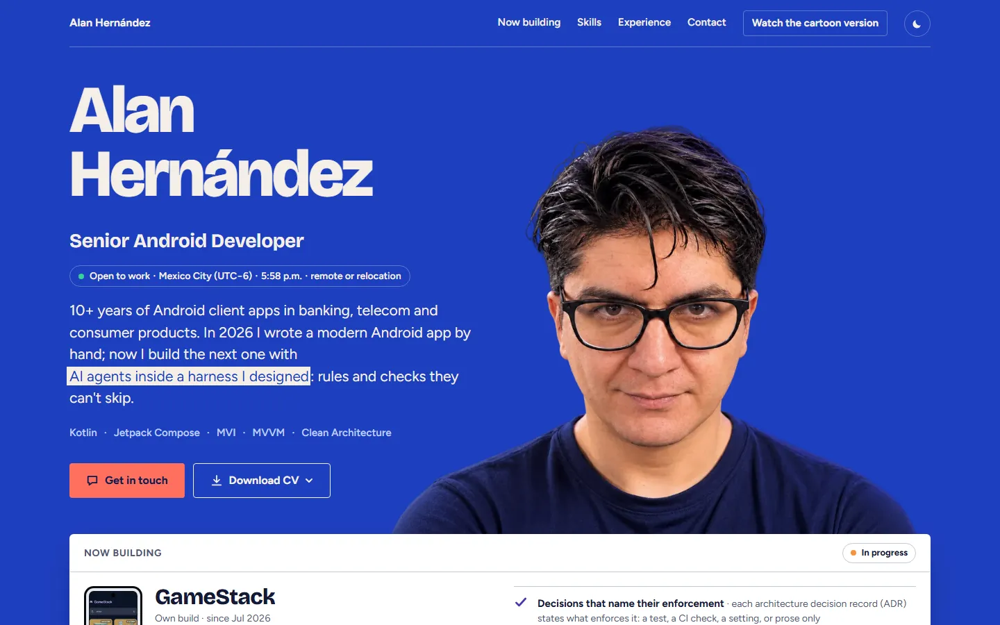
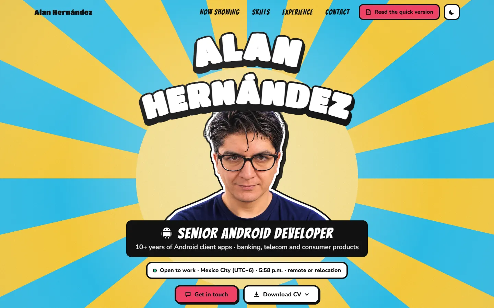
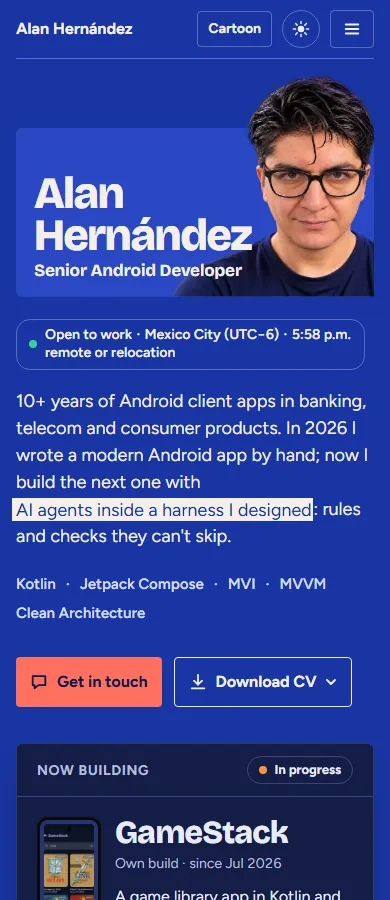
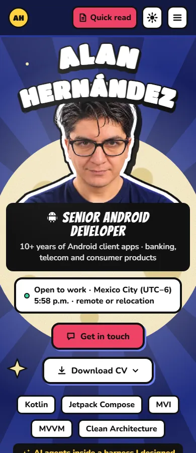
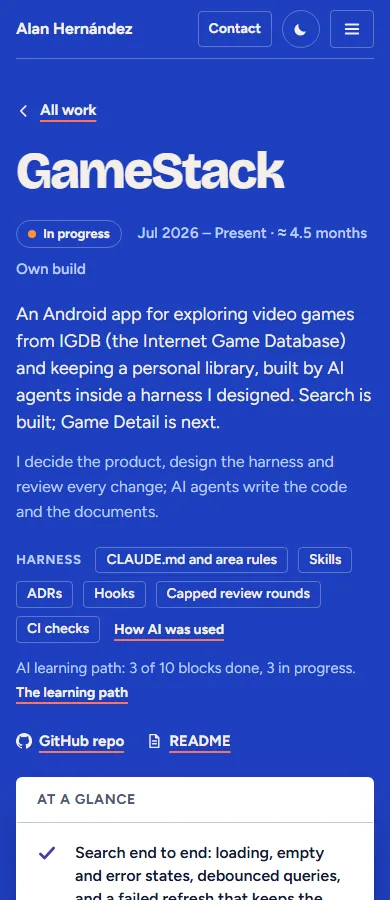
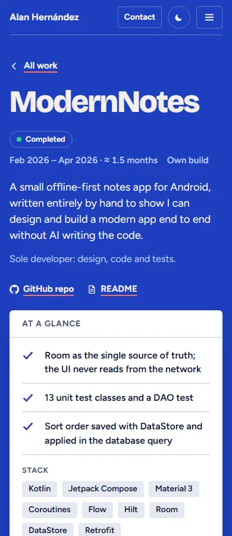
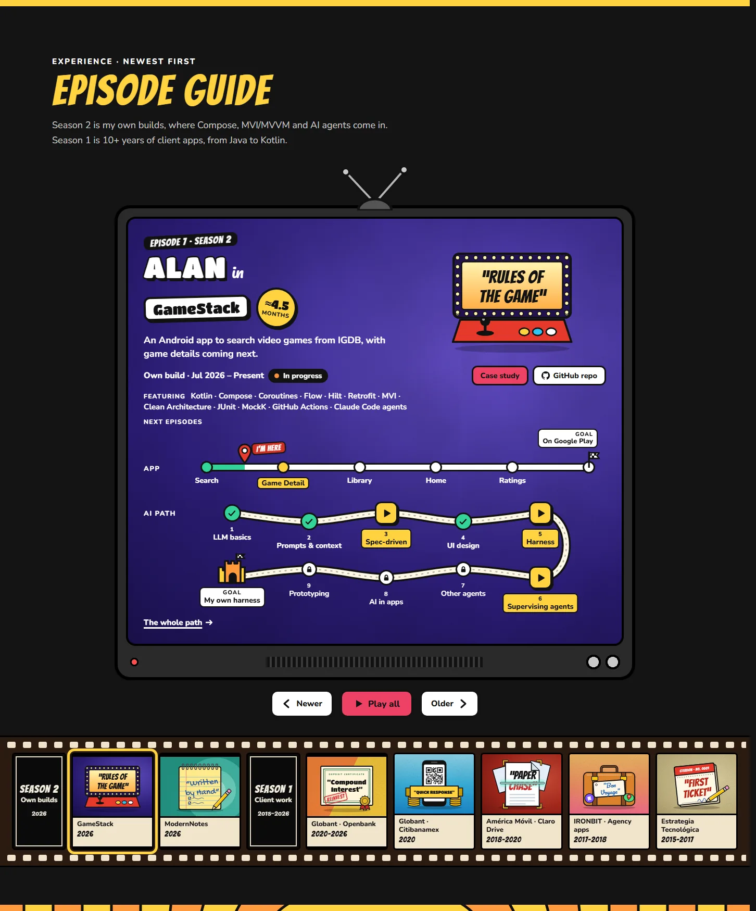
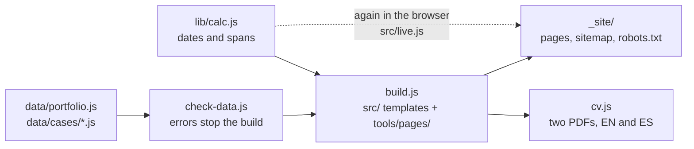

# alanhernandez.dev

[](https://github.com/voltek/portfolio-site/actions/workflows/checks.yml)
[](LICENSE)
[](https://claude.com/claude-code)

The portfolio of **Alan Hernández**, Senior Android Developer: a static site for two readers. Recruiters scan it
in seconds; hiring managers audit it, following every claim into a case study and a public repo
([`PRODUCT.md`](PRODUCT.md) § *Users*). Served at alanhernandez.dev.

<table>
  <tr>
    <td align="center" width="50%">
      <br>
      <sub><b>Quick</b>, the quick read and the main door</sub>
    </td>
    <td align="center" width="50%">
      <br>
      <sub><b>Cartoon</b>, the same landing as a cartoon program</sub>
    </td>
  </tr>
</table>

## 🌐 The site

One landing in two versions, and a page for each project. Every page has a light and a dark theme and works
from 360 px phones to wide desktops.

| Page | Built from | What it is for |
|---|---|---|
| **Quick** (`index.html`) | [`src/quick.html`](src/quick.html) | Role, stack, years and every job at once: a recruiter decides in seconds |
| **Cartoon** (`cartoon.html`) | [`src/cartoon.html`](src/cartoon.html) | The expressive version: each job an episode, the skills a cast, the learning path a level map |
| **Case studies** (`gamestack.html`, `modernnotes.html`) | [`src/case.html`](src/case.html), [`data/cases/`](data/cases/) | The close read: architecture, decisions, tests, what is missing, each claim linked to its file |
| **CV** (two PDFs, English and Spanish) | [`src/cv.html`](src/cv.html) | Quick's sober direction on two pages, readable by an applicant tracker |

<table>
  <tr>
    <td align="center" width="25%">
      <br>
      <sub>Quick, dark</sub>
    </td>
    <td align="center" width="25%">
      <br>
      <sub>Cartoon, dark</sub>
    </td>
    <td align="center" width="25%">
      <br>
      <sub>GameStack case</sub>
    </td>
    <td align="center" width="25%">
      <br>
      <sub>ModernNotes case</sub>
    </td>
  </tr>
</table>

<p align="center">
  <br>
  <sub>Cartoon's episode guide: one episode per job, newest first. The project in progress draws its roadmap and the
  AI learning path as a level map.</sub>
</p>

The two versions share only the data, the status colors and the role logic; neither borrows the other's colors,
fonts or outlines ([`DESIGN.md`](DESIGN.md)).

## 🏗️ How it is built

Plain HTML, CSS and JavaScript, no framework and no npm dependencies. One data file feeds every page and both CVs,
and one build step in plain Node turns them into static files.



- **One data file.** [`data/portfolio.js`](data/portfolio.js) holds the profile, jobs, projects, skills and learning
  path, every text as `{ en, es }`. Quick and Cartoon render from it, so they can never disagree; a new project or a
  finished one is a data change, never a redesign. The recipes are in [`DATA.md`](DATA.md).
- **No number typed by hand.** "10+ years", "≈ 4.5 months", years per skill and episode numbers come from the dates,
  through [`lib/calc.js`](lib/calc.js). The build fills the pages with the values of its day, for search engines and
  readers without JavaScript; [`src/live.js`](src/live.js) recomputes them against the day someone reads the page.
- **One renderer per page.** [`tools/pages/`](tools/pages/) fills each template's `{{@key}}` slots; a case study's
  sections are optional, and one left out of its data file leaves the page and its bar.
- **Claims pinned to a commit.** Each project's claims carry the commit and day they were checked against its public
  repo (`pin` in the data). [`tools/repo-changes.js`](tools/repo-changes.js) lists the claims that rest on a file that
  changed since.
- **Light downloads.** Fonts are self-hosted; [`tools/images.js`](tools/images.js) makes WebP copies of every image
  the data lists, at the widths `srcset` picks, under the weight budgets in [`lib/images.js`](lib/images.js).

### 🛠️ Tech stack

| Area | Choice |
|---|---|
| **Pages** | HTML, CSS and JavaScript, no framework; design tokens in [`tokens.css`](tokens.css) |
| **Build** | Plain Node, no npm dependencies ([`tools/build.js`](tools/build.js)) |
| **Images** | WebP with `srcset`, made with Edge headless: nothing to install ([`tools/images.js`](tools/images.js)) |
| **CV** | Printed to PDF by Edge or Chrome headless at every build ([`tools/cv.js`](tools/cv.js)) |
| **Share image** | `assets/og.jpg`, drawn from the data by [`tools/og.js`](tools/og.js) |
| **CI** | GitHub Actions: one required check on every pull request ([`checks.yml`](.github/workflows/checks.yml)) |
| **Hosting** | GitHub Pages under a custom domain: the domain is the only running cost |

## ✅ What checks it

| Check | Where | When | What it catches |
|---|---|---|---|
| **Data** | [`check-data.js`](tools/check-data.js) | Before every build, and in CI | Broken ids, invalid dates, a text without its Spanish, a pin without a date, a screen that does not exist |
| **Build** | [`build.js`](tools/build.js) | Locally, and in CI | Any local link or image that does not exist in the built site |
| **Repo rules** | [`check-repo.js`](tools/check-repo.js) | In CI | A private or generated path tracked; a pull request's title, body or branch out of format |
| **Private values** | [`pre-push`](tools/git-hooks/pre-push) | Before every push | A phone, salary or personal email in a commit; the patterns live outside this repo |
| **CV read-back** | `cv.js --check` | On demand | Each PDF read back with `pdftotext`, as an applicant tracker would: every section present and in order |
| **Screenshots** | [`shots.js`](.claude/skills/screenshots/shots.js) | Before a pull request | JavaScript errors, failed requests and sideways overflow, at phone and desktop widths, light and dark |

`main` takes changes only through pull requests, and a pull request merges only with the check green.

## 🧭 Key decisions, and what they cost

| Decision | Why | Cost, accepted |
|---|---|---|
| No framework, no npm dependencies | A static portfolio needs neither, and there is nothing to update or audit | The templates, the renderers and the build are written by hand |
| One data file for every page and the CV | Quick, Cartoon and the CV can never disagree | A new kind of section means a renderer change, not just data |
| Dates computed, never typed | The site never goes stale between deploys | The same file must run in Node and in the browser |
| One landing in two versions, Quick as the main door | Recruiters decide in seconds; Cartoon is for getting to know me | Every visual change touches both |
| Every project claim pinned and linked | A hiring manager can check each one against the repo | When a repo moves, the claims are re-checked and re-pinned |
| Static files only, no backend | The domain stays the only cost | Contact is an email address and links, no form |

## 🤖 How AI was used

Built with [Claude Code](https://claude.com/claude-code) under my full supervision. I set the direction, made every
product and design decision, approved every text before it reached the site, and reviewed every change; the agent
wrote most of the code.

The agent works inside a light harness, a smaller version of the one [GameStack](https://github.com/voltek/GameStack)
documents in full:

- **Rules:** [`CLAUDE.md`](CLAUDE.md) binds every turn; [`.claude/rules/`](.claude/rules/) load by path (content,
  design, harness).
- **Skills:** [`screenshots`](.claude/skills/screenshots/SKILL.md) to see and check pages,
  [`sync-project`](.claude/skills/sync-project/SKILL.md) to re-check a project's claims against its repo,
  [`close-session`](.claude/skills/close-session/SKILL.md) to review, merge on my yes and record where things stand.
- **Hooks and permissions:** [`settings.json`](.claude/settings.json) denies force pushes and skipped git hooks, and
  asks before any merge; a session-start hook loads the state of the work.
- **Design tooling:** the third-party [impeccable](https://github.com/pbakaus/impeccable) skill, not included here;
  [`skills-lock.json`](skills-lock.json) pins its version.
- **Kept private:** the copy deck every text passes through, my notes and the session state live in a separate
  private repository.

## ▶️ Running it locally

**You need:** Node 24 (the version CI runs), and Edge or Chrome to print the CV.

```sh
node tools/build.js                    # check the data, then build _site/ and the two CV PDFs
node tools/serve.js                    # http://localhost:8080/, gzipped as GitHub Pages serves it
node tools/build.js --today=2027-09-15 # build as if it were another day
node tools/cv.js --check               # print the CVs and read them back
```

## 🗺️ Next steps

- **The site in Spanish**, beside the English one.
- **This site as a case study**, like GameStack's and ModernNotes'.

## 👤 Author

Built by **Alan Hernández** with Claude Code. A personal project; pull requests from others are not expected.

- **GitHub:** [@voltek](https://github.com/voltek)
- **LinkedIn:** [alan-hernandez-voltek](https://www.linkedin.com/in/alan-hernandez-voltek/)
<!-- Uncomment once the site is live; check whether it answers on the bare domain or on www.
- **Portfolio:** [alanhernandez.dev](https://alanhernandez.dev/)
-->

## 📄 License

- **Code:** [MIT](LICENSE).
- **Not covered:** the texts, photos and images, © Alan Hernández, all rights reserved; the app screens in the
  screenshots show game art that belongs to its owners.
